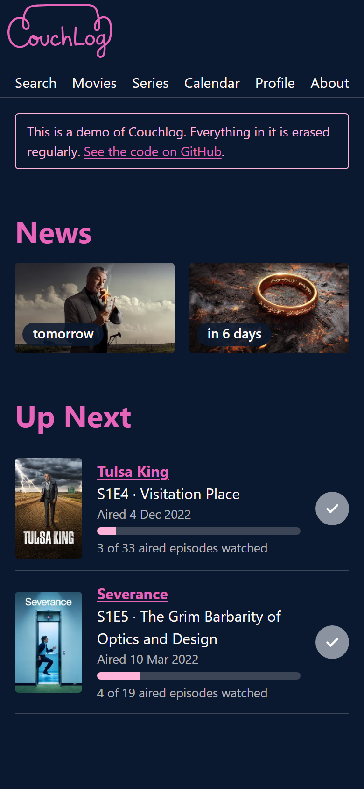
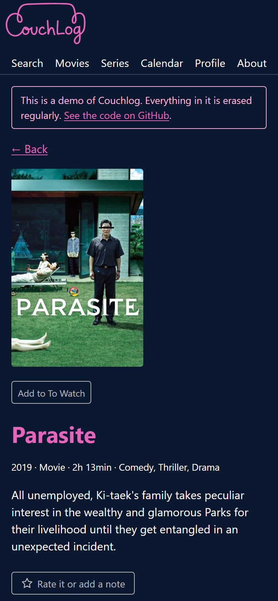
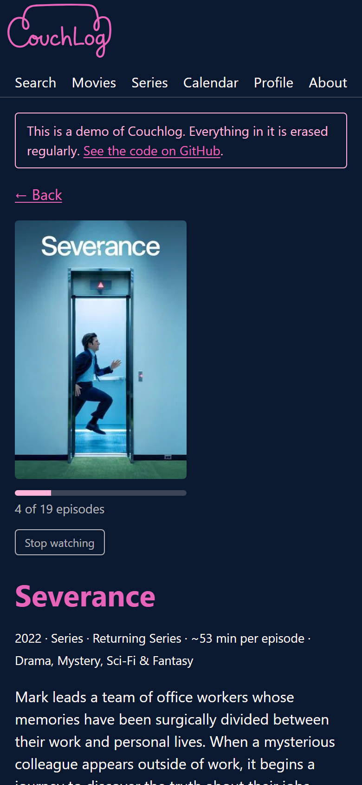
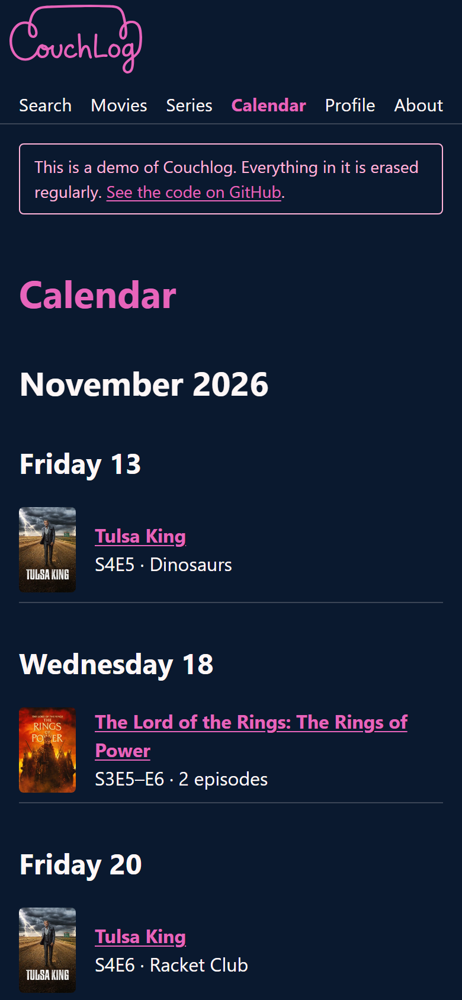

# Couchlog

_Log what you watch from the couch._

Couchlog is my personal web app for the movies and series I watch: a To Watch list, a history of everything I have seen, and a calendar of what comes out next. It runs on a Raspberry Pi at home, and I use it on my phone.

**Try it:** [couchlog-demo.ana-cata.com](https://couchlog-demo.ana-cata.com). Press **Try the demo** to get a throwaway account with sample titles. The demo sleeps when nobody uses it, so the first visit can take about a minute. Everything in it is erased after 24 hours.

| Home | A movie | A series | Calendar |
|---|---|---|---|
|  |  |  |  |

## What it does

- **Search** movies and series and add them to a **To Watch** list.
- **Mark a movie as watched.** Every watch is its own dated entry, so watching it again counts too. Rate it or add a note.
- **Series:** mark an episode, a whole season, or everything up to an episode. Progress bars show how far you are, and **Up Next** on Home shows the next episode of each series you are watching.
- **Calendar:** the upcoming episodes of your series and the cinema and streaming dates of the films on your list, in your own time zone.
- **Everything can be undone,** and every change has a test that proves it.
- Works on a phone as well as a computer.

## How it is built

- **Python 3.14 and Django**, with **htmx**: the server builds the pages, and htmx swaps parts of them in place, so there is no JavaScript app and no build step. Styling with **Pico CSS**. Data in **SQLite**.
- **Data from TMDB**, saved in Couchlog's own database. Upcoming episode dates also come from **TVmaze**, because TMDB often lists only the first episode of a new season.
- **At home:** Docker on a Raspberry Pi, with a daily task that refreshes the calendar and backs up the database to Cloudflare R2.
- **From outside the home:** Cloudflare Tunnel with Cloudflare Access in front, so only emails on my allow list get in (with a one-time code), and the router stays closed.
- **The demo** is a separate copy on Render's free plan, with its own database and limits, away from the Pi and my data.
- **Tests:** pytest with made-up TMDB answers and a fixed "today", and Playwright for tests in a real browser. GitHub Actions runs the lint and the tests on every pull request.

## How I worked, and what I learned

I decided what to build and when it was done; [Claude Code](https://claude.com/claude-code), an AI coding assistant, wrote the code, the tests and the docs. Everything starts from [plan.md](plan.md): each feature is a small card on the project board with a "Done when" test, built on its own branch and merged through a pull request that I review.

- **Estimates were far too high.** About 10 to 12 weeks were planned up to the Pi; the first version, the polish and most extras took about a week. Cards stayed small anyway.
- **Using the app found more than the plan did.** Many cards came from trying the app, first on the PC and then on my phone, not from the plan.
- **One data source was not enough.** TMDB often lists only the first episode of a new season, so TVmaze became a second source for upcoming dates.
- **Updating a page in place has side effects.** htmx changes the page without reloading it, which broke the Back button twice. Tests in a real browser catch these; tests on the server alone did not.
- **The real phone finds what tests cannot.** My iPhone showed a frozen page on Back, and Safari's toolbar swallowing a tap near the bottom of the screen. Checking on the phone is part of every deploy.
- **"Free" needs a limit of my own.** Cloudflare has no hard spending limit for R2, so the backups stop at 5 GB. The demo has its own limits too.
- **Security before going public.** Before this repo became public, the code, the packages, the Docker image, the live app and the demo were checked ([docs/security-check.md](docs/security-check.md)).

## Run it yourself

You need [uv](https://docs.astral.sh/uv/) and a free [TMDB API key](https://www.themoviedb.org/settings/api).

1. `uv sync`
2. Copy `.env.example` to `.env` and put your TMDB key after `TMDB_API_KEY=`.
3. `uv run python manage.py migrate`, then `uv run python manage.py createsuperuser` to make your account.
4. `uv run python manage.py runserver` and open http://localhost:8000.

The full steps, the commands, the tests, Docker and where things are in the code are in [docs/running.md](docs/running.md). Each page of the app has its own page in [docs/](docs/).

## Credits

This product uses the TMDB API but is not endorsed or certified by TMDB. Movie and series details and posters come from [TMDB](https://www.themoviedb.org/).

Upcoming episode dates also come from [TVmaze](https://www.tvmaze.com/), whose data is licensed [CC BY-SA](https://creativecommons.org/licenses/by-sa/4.0/).

## Licence

The code is under the [MIT licence](LICENSE). It does not cover:

- Couchlog's logo and icons: the files in `Identity/` and `logo-couchlog.svg`, `favicon.svg` and `apple-touch-icon.png` in `core/static/core/`.
- The TMDB logo (`core/static/core/tmdb-logo.svg`), which belongs to TMDB.
- Pico CSS (`pico.min.css`, MIT) and htmx (`htmx.min.js`, Zero-Clause BSD), which keep their own licences.
- The screenshots, which show posters from TMDB.
